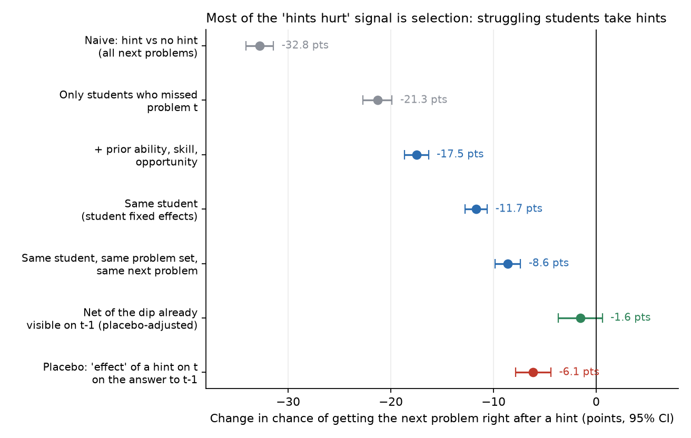
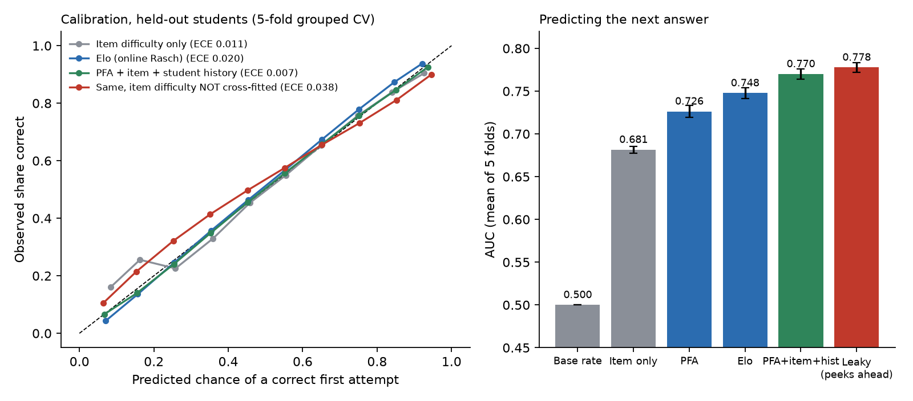
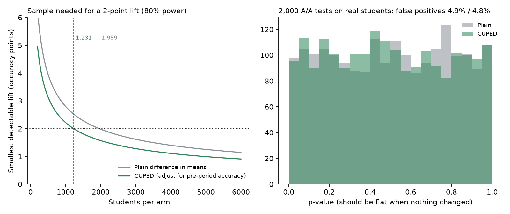

# Hintsight

I built Hintsight to answer three questions a math-practice platform's data team gets all the time, using real student logs instead of toy data:

1. **Do hints help?** The naive answer from the logs is badly biased because struggling students are the ones who ask for hints. I show how biased, then estimate it properly.
2. **Will this student get the next problem right?** The prediction an adaptive practice system (pick the next problem) runs on, evaluated so that no student leaks between train and test.
3. **How big does an A/B test need to be?** Minimum detectable effects on the real variance of student accuracy, a CUPED variance reduction, and simulated A/A and A/B tests on the real students to check both.

The plain-English version for a curriculum team is in [MEMO.md](MEMO.md). What the data leaves out, and how that limits each conclusion, is in [DATA.md](DATA.md). The plan I wrote before running anything is in [SPEC.md](SPEC.md).

## Data

ASSISTments 2009-2010 skill-builder data (public, free, from WPI): 275,458 first attempts on main problems by 4,217 middle-school students, 18,209 problems, 250 classes, 75 schools. `scripts/download_data.sh` downloads the 64 MB file and checks its SHA-256. Everything is loaded into DuckDB and the feature work is SQL ([src/hintsight/sql/build.sql](src/hintsight/sql/build.sql)): pairing each problem with the next one in the same problem set, running prior-success and prior-failure counts that exclude the current row, pre-assignment ability, and each student's pre/post halves.

Nothing in the results table is simulated except where it says so: the A/A and A/B power checks re-randomize the real students, and the A/B "lift" is planted on top of their real answers.

## How to run

```bash
python -m venv .venv && . .venv/bin/activate
pip install -r requirements.txt
./scripts/download_data.sh          # 64 MB, checksum verified
python scripts/run_all.py --rebuild # builds data/assistments09.duckdb, writes results/results.json and figures/ (about 45 s)
python -m pytest -q                 # 23 tests on synthetic data, no download needed
```

## Results

All numbers are copied from `results/results.json` (one run of `scripts/run_all.py`).

### 1. Hints and the next problem (linear probability models, 95% CIs clustered by student)

| Comparison | Effect of a hint on next-problem correctness | n |
|---|---|---|
| Naive: hint vs no hint, all pairs | **-32.8 pts** [-34.1, -31.4] | 209,220 pairs |
| Only pairs where problem t was missed | -21.3 pts [-22.7, -19.9] | 81,041 |
| + prior ability, skill, opportunity | -17.5 pts [-18.7, -16.3] | 81,041 |
| Student fixed effects | -11.7 pts [-12.8, -10.6] | 81,041 |
| Student x problem-set FE + next-problem FE | **-8.6 pts** [-9.9, -7.4] | 81,041 |
| Placebo: "effect" of a hint on t on the answer to t-1 | -6.1 pts [-7.9, -4.4] | 61,355 |
| Placebo-adjusted (change from t-1 to t+1) | **-1.6 pts** [-3.7, +0.6], p = 0.16 | 61,355 |

The naive estimate is off by 24.2 points against the within-student estimate (74% of it is selection). The placebo shows the remaining -8.6 is mostly the same selection operating within a session, and netting it out leaves an effect indistinguishable from zero. Bottom-out (answer-revealing) hints: -10.3 pts vs -5.9 pts for partial hints, same specification.



### 2. Predicting next-answer correctness (5-fold GroupKFold by student)

| Model | AUC | Log loss | Brier | ECE |
|---|---|---|---|---|
| Base rate | 0.500 | 0.642 | 0.225 | 0.008 |
| Item difficulty only | 0.681 | 0.595 | 0.204 | 0.011 |
| PFA (performance factors analysis) | 0.726 | 0.565 | 0.191 | 0.011 |
| Elo / online Rasch | 0.748 | 0.551 | 0.185 | 0.020 |
| **PFA + item difficulty + student history** | **0.770** | **0.531** | **0.177** | **0.007** |
| same, item difficulty not cross-fitted | 0.762 | 0.546 | 0.182 | 0.038 |
| LEAKY: student accuracy over all rows incl. future | 0.778 | 0.523 | 0.174 | 0.008 |

Means over 5 folds (fold SD of AUC is about 0.006). Item difficulty is estimated in SQL from training-fold students only, and for training rows it is cross-fitted (each training student's difficulty comes from the other training students). Skipping that cross-fit leaves the row's own label inside the feature, and calibration error goes from 0.007 to 0.038. The leaky row is there on purpose: peeking at a student's future adds 0.008 AUC that would not exist in production.



### 3. Experiment design on real variance (2,112 students with at least 20 problems)

| Quantity | Plain difference in means | CUPED (pre-period accuracy) |
|---|---|---|
| SD of post-period accuracy | 0.223 | 0.177 |
| Variance reduction | | **37.2%** (rho = 0.61) |
| Students per arm for a 2-pt lift (alpha 0.05, power 0.8) | **1,959** | **1,231** |
| MDE with all 1,056 per arm | 2.72 pts | 2.16 pts |
| A/A false-positive rate, 2,000 re-randomizations | 4.90% | 4.75% |
| Power at a planted 2.16-pt lift, 2,000 sims (analytic) | 60.9% (60.3%) | 80.8% (80.1%) |

Monte Carlo SE on a 5% rate with 2,000 sims is about 0.5 pts, so both A/A rates are consistent with 5%. If whole classes had to be randomized, the class ICC of post-period accuracy is 0.40 with an effective class size of 16.8, a design effect of 7.4: about 14,414 students per arm for the same 2-point test (CUPED brings the ICC to 0.20).



## Code

| File | What it does |
|---|---|
| `src/hintsight/sql/build.sql` | All feature tables, in DuckDB SQL |
| `src/hintsight/fe.py` | OLS with absorbed fixed effects (alternating projections) and cluster-robust SEs |
| `src/hintsight/hints.py` | Part 1 estimate ladder, placebo, placebo-adjusted change |
| `src/hintsight/predict.py` | Part 2 models (PFA, Elo, baselines), grouped CV, cross-fitted item difficulty, ECE |
| `src/hintsight/experiment.py` | Part 3 MDE, CUPED, A/A and planted A/B simulations, ICC/design effect |
| `scripts/run_all.py` | Reproduces `results/results.json` and the figures |

The tests check the things that would silently ruin the numbers: the absorbed-FE slopes equal a dummy-variable regression and the clustered SEs equal statsmodels; on simulated data with a known hint effect and built-in selection, the naive estimate is badly wrong and the within-student estimate recovers the truth (and a true null comes back as a null); SQL prior counts never include the current row; item difficulty does not move when a test student's answers change; CUPED variance reduction equals rho squared; A/A false-positive rate is near 5%.

## Limits

* Part 1 is observational. The placebo test is evidence that selection remains even within a student and problem set, so I report "no detectable effect on the next problem", not "hints do not work". Hints could help later learning that the next problem does not measure.
* The data has no timestamps; "pre" and "post" are halves of each student's own sequence, which stands in for pre-launch data.
* 2009-10 Massachusetts-area middle-school classwork is a different population from AoPS students, so effect sizes and variances are a starting point, not a forecast.
* Linear probability models are used in Part 1 for interpretable point differences; they can predict outside [0, 1], which does not affect the average-effect estimates.
* Full list in [DATA.md](DATA.md).
